# Guia completo — meu pet no jogo (RPG Paper Maker + Piskel)

Para o **professor**. Faça uma vez antes da aula (~25 min).

- **Piskel** — <https://www.piskelapp.com> → `Create Sprite`. Grátis, no navegador, sem conta.
- **RPG Paper Maker** (não é o RPG Maker) — <https://rpg-paper-maker.com/play> → `OPEN WEB APP`. Testado nas versões **3.2.30** e **3.2.32**.

> ⚠️ Os dois guardam tudo **no navegador daquele PC**. Antes de sair: `Save as .piskel` no Piskel e `CTRL + E` no RPGPM.

---

## A ideia principal

O boneco que anda no mapa é **uma imagem só** com 16 desenhos em grade 4 × 4
(folha de sprites). O jogo recorta um pedaço por vez:

| Linha | Quadros no Piskel | O jogo mostra quando o herói... |
|:---:|:---:|---|
| 1 | 1 – 4 | anda pra baixo (de frente) |
| 2 | 5 – 8 | anda pra esquerda |
| 3 | 9 – 12 | anda pra cima (de costas) |
| 4 | 13 – 16 | anda pra direita |

As 4 colunas são os passos: o jogo troca de coluna enquanto anda → animação.

Exemplo pronto: [pipoca-grande.png](pipoca-grande.png) (ampliado) e
[pipoca.png](pipoca.png) (o arquivo de verdade, 128 × 128).

---

## ⚠️ O tamanho tem que ser 128 × 128

Testado: uma folha **64 × 64** (quadros 16 × 16) importa sem erro, aparece
na lista, mas **o herói some no jogo** (só grama). Com **128 × 128**
(quadros 32 × 32, igual aos personagens que vêm no programa) aparece certo.

Por isso: desenha em **16 × 16** no Piskel (rápido de pintar) e exporta com
**`Scale 2.0x`**. Cada pixel vira 2 × 2 e a folha sai 128 × 128.

O pet fica do tamanho de 2 quadrados do mapa, um pouco maior que os
moradores. Se quiser ele menor, deixa 3–4 linhas vazias em cima do desenho.

---

## Passo 1 — Piskel: desenhar

Fotos tiradas em 2026-11-28. O círculo vermelho mostra onde clicar; os
números dão a ordem.

**1.1** `Create Sprite` → ícone **`Resize`** (2º da coluna da direita).

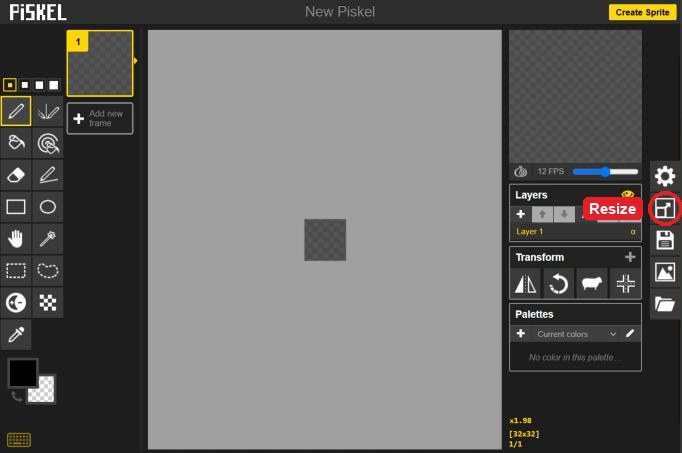

**1.2** `Width` 16 e `Height` 16 → botão `Resize`.

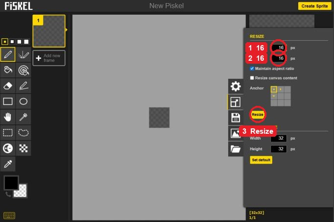

**1.3** Lápis + cor → pinta o pet **de frente** no quadro 1: contorno escuro,
pés encostados na última linha, centralizado. 2–4 cores bastam. Embaixo à
direita tem que estar `[16x16]`.

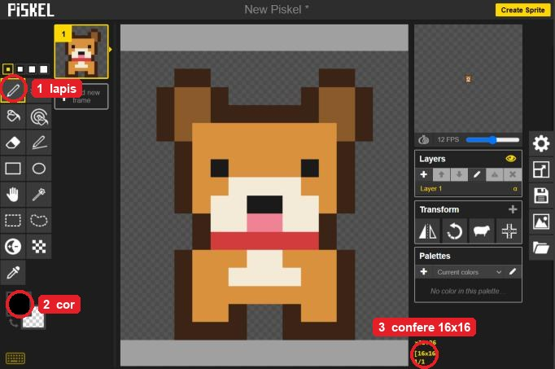

**1.4** Passa o mouse no quadro 1 → ícone de **duplicar** (canto de baixo).
Clica até ter 16 quadros.

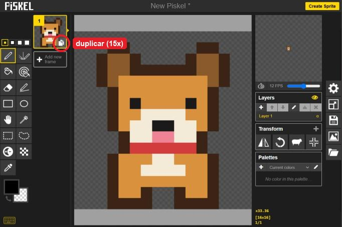

**1.5** Confere `16/16` embaixo à direita.

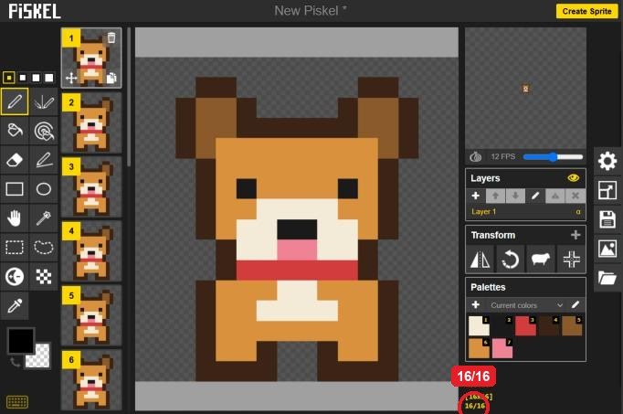

## Passo 2 — Piskel: exportar e salvar

**2.1** Ícone **`Export`** (quadrinho com montanha) → `Scale` **2.0x** → aba
**`PNG`** → `Columns` **4** (com 16 quadros ele já põe 4 sozinho) → confere
**128 x 128 px, 16 frames** → `Download`. Renomeia pra `pet.png` (sem espaço,
sem acento).

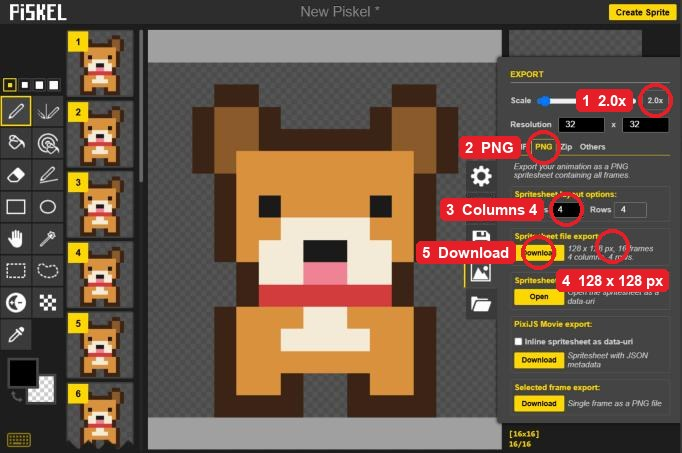

**2.2** Disquete → **`Save as .piskel`**. É o desenho que dá pra editar
depois; o PNG não volta a ser editável com quadros.

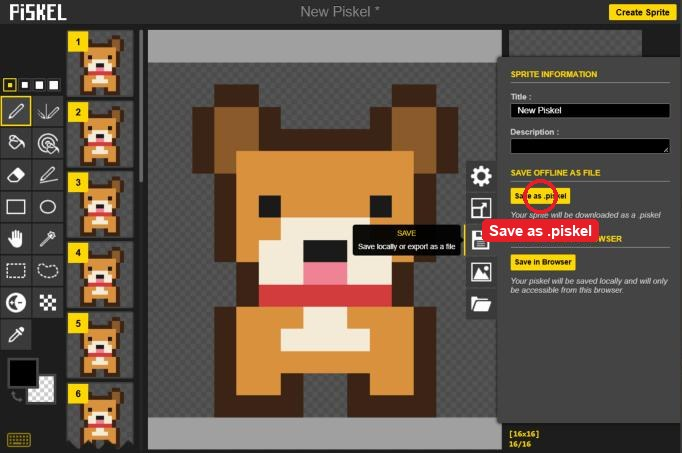

## Passo 3 — RPGPM: trocar o herói

**3.1** `New project...`

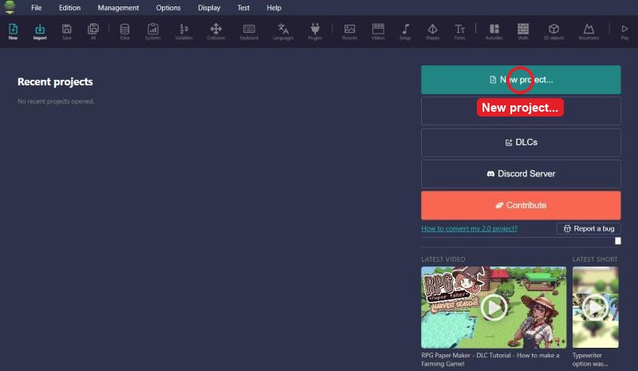

**3.2** Nome sem espaço → `Default` → `OK`.

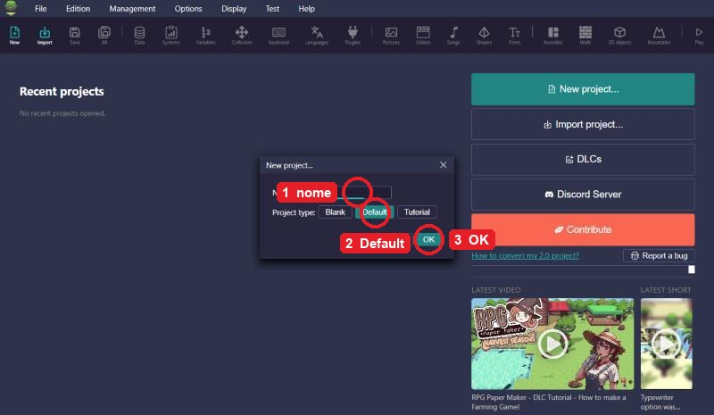

**3.3** Ícone **`Systems`** na barra de cima.

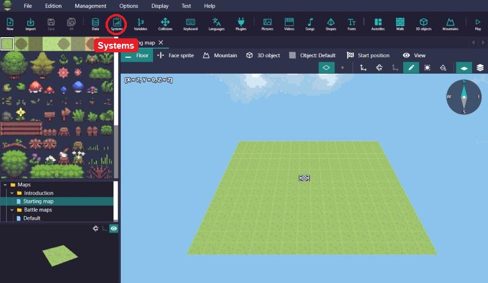

**3.4** Aba **`Models`** (a última).

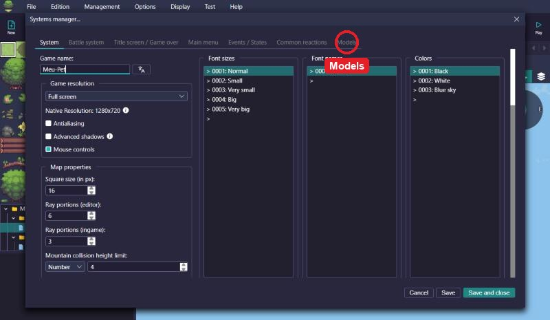

**3.5** Botão **`Hero`**.

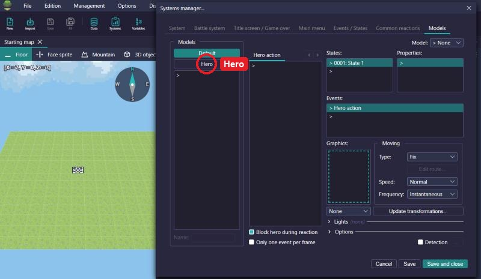

**3.6** **Duplo clique** no quadro `Graphics` (onde está o Lucas).

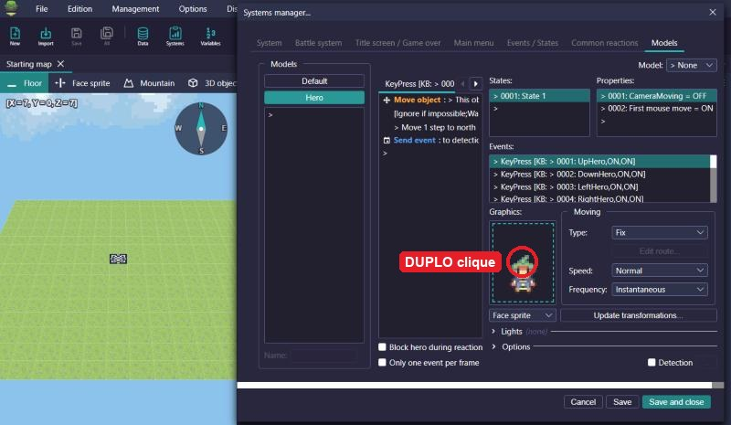

**3.7** `import...` (embaixo da coluna do meio) → abre a janela do Windows →
escolhe o `pet.png`.

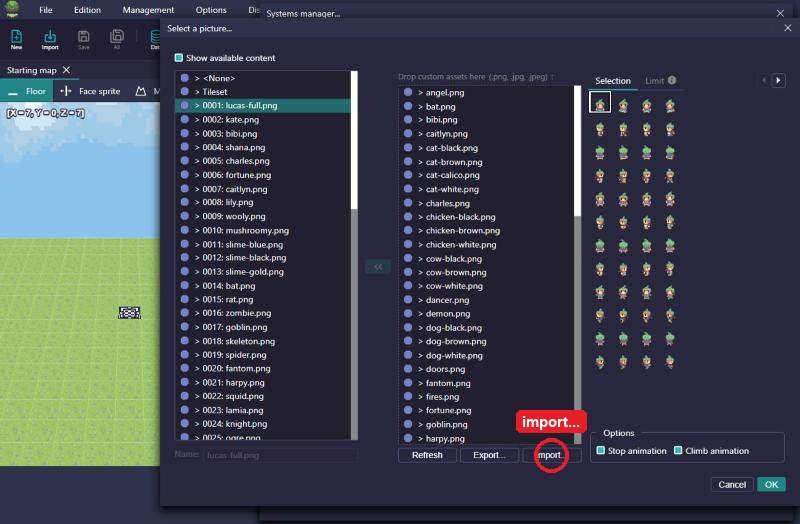

**3.8** O `pet.png` aparece **no fim** da lista do meio, com bolinha roxa.
Clica nele → clica na setinha **`<<`**.

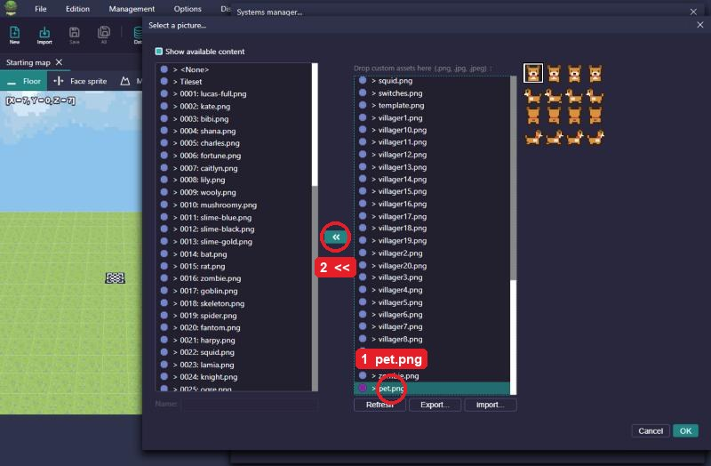

**3.9** Ele aparece no fim da lista da esquerda (`0070: pet.png`), já
selecionado. `Stop animation` e `Climb animation` **desmarcados** → `OK`.

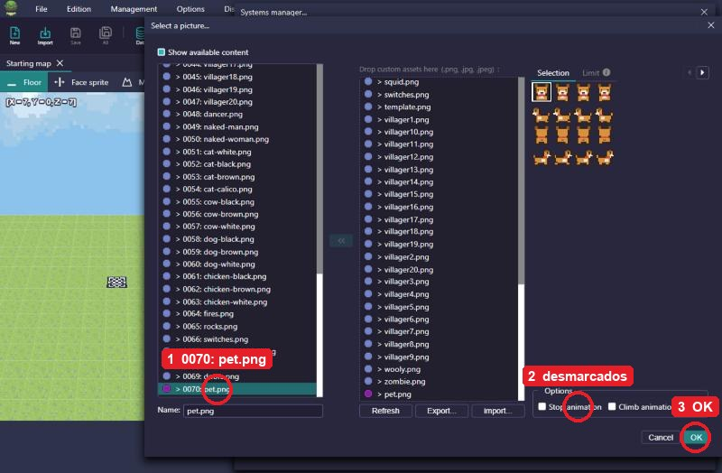

**3.10** O pet aparece em `Graphics` → **`Save and close`**.

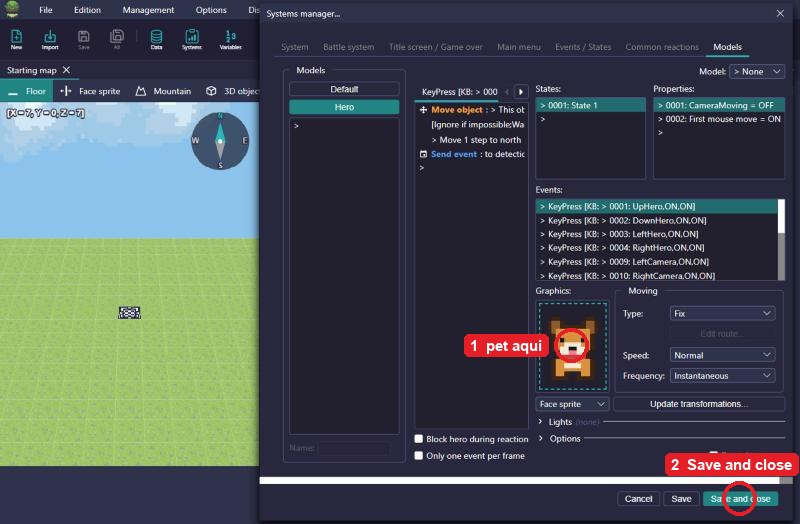

**3.11** **▶ Play** (canto direito da barra) → `New game`. A primeira carga
pode ficar uns 20 s em "Loading..."; se passar de 1 minuto, recarrega a aba
do jogo.

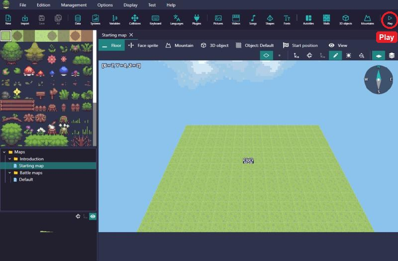

**3.12** Pronto: o pet no lugar do Lucas, anda com **WASD**.

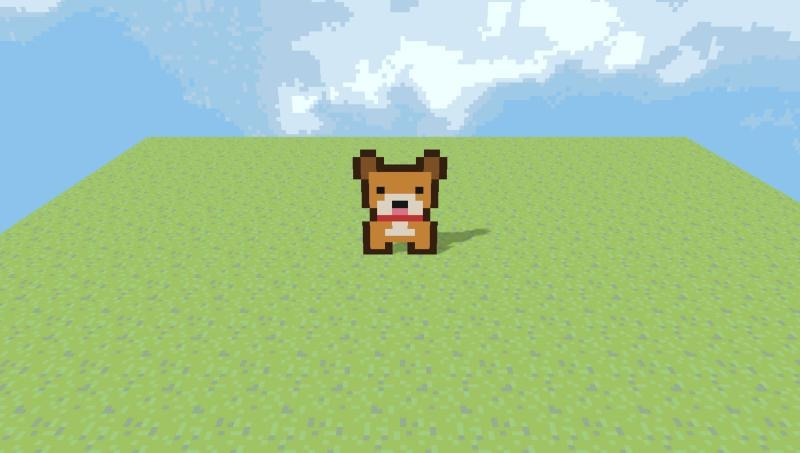

> `Data` → `Heroes` → `Character` **não** muda o boneco do mapa (só o do
> menu). O do mapa é sempre `Systems > Models > Hero`.

**✅ Marco mínimo:** o pet dele andando no mapa, mesmo que sempre de frente.

---

## Passo 4 (bônus) — virar pros lados

1. Quadros 5–8: pet de lado **olhando pra esquerda**.
2. Quadros 9–12: de costas.
3. Quadros 13–16: copia o de lado (duplica o quadro 5 e arrasta pro fim) →
   `Transform` → 1º ícone (espelho).
4. Opcional: nos quadros 2 e 4 de cada linha, mexe as patas 1 pixel.
5. Exporta como **`pet2.png`** (nome novo evita confusão com o antigo) →
   importa igual ao passo 3 → troca no `Hero`.

## Passo 5 (bônus) — o dono

Receita das aulas passadas: no mapa, objeto `Dono` com um morador qualquer
(ou outro desenho do Piskel, importado igual) → `Hero action` →
`Show text...` "Você me achou!". Um gato no caminho dá a dica.

---

## O jogo pronto

[../Pet-Perdido.zip](../Pet-Perdido.zip) → `File > Import project...`.

| Objeto | Onde | Fala |
|---|---|---|
| Pipoca (herói) | meio do mapa | — |
| Gato | embaixo à esquerda | "Miau... Procurando seu dono?" / "Vi ele lá em cima, perto das árvores." |
| Dono | fundo à direita | "PIPOCA! Você me achou!" / "Vamos pra casa, tem biscoito te esperando!" |

Testado no navegador: Pipoca aparece, anda, vira pros 4 lados e conversa
com o Dono.
